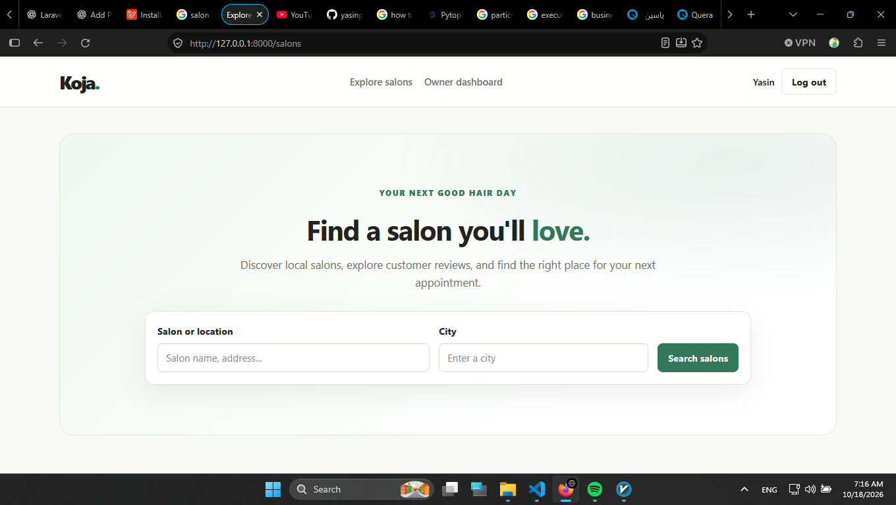
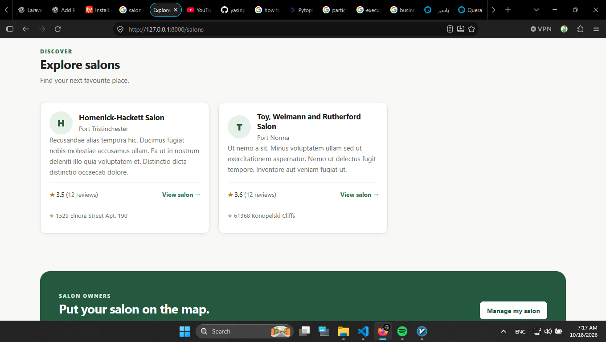
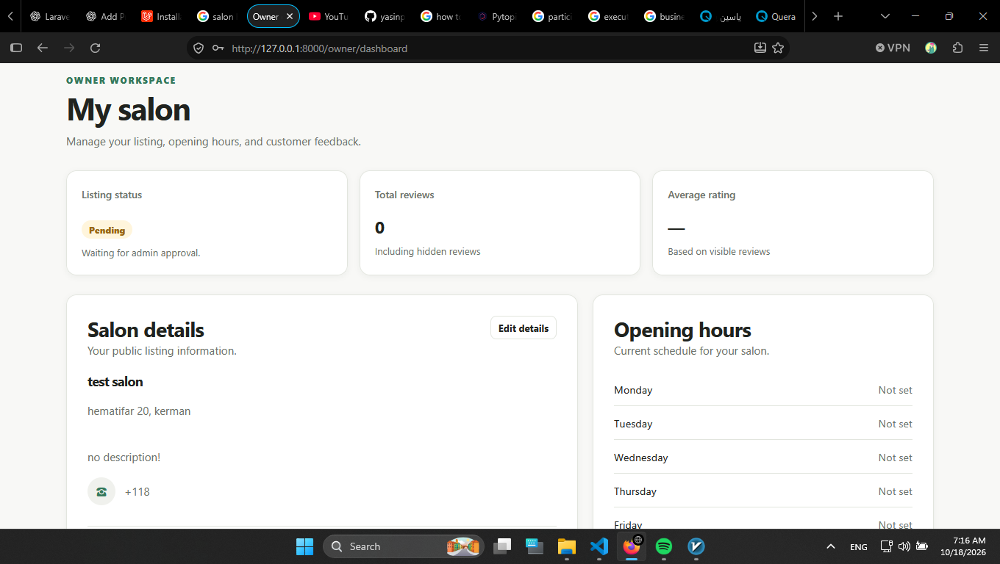
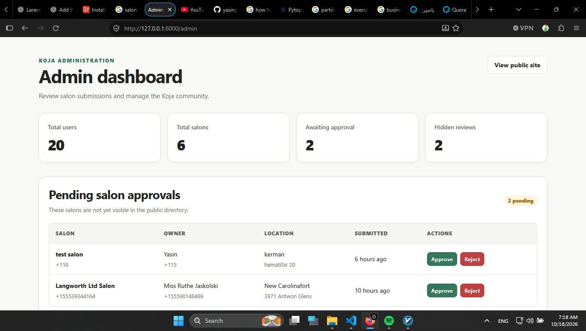
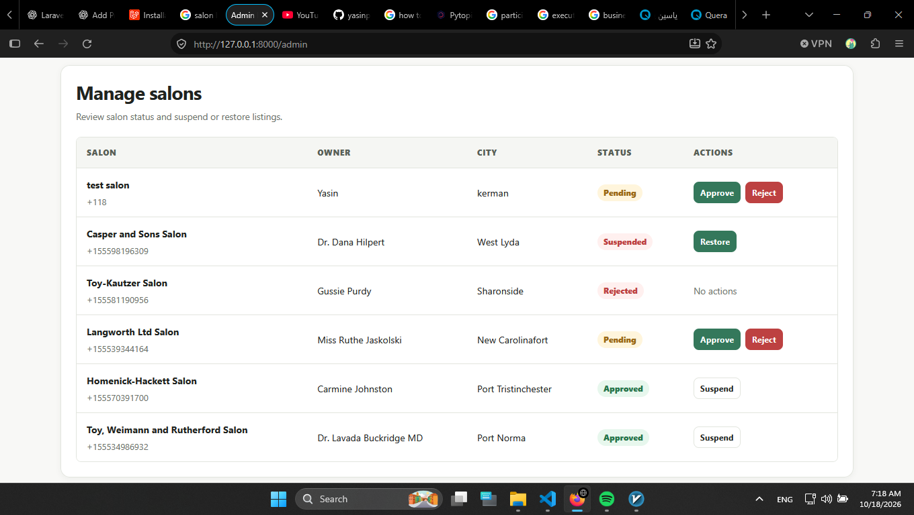
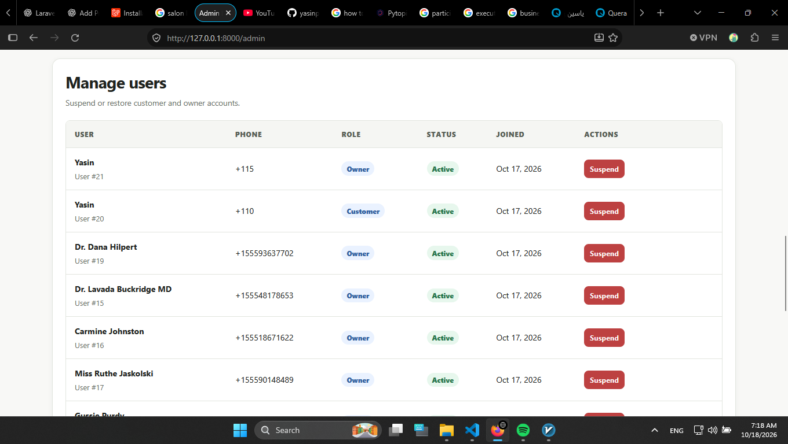
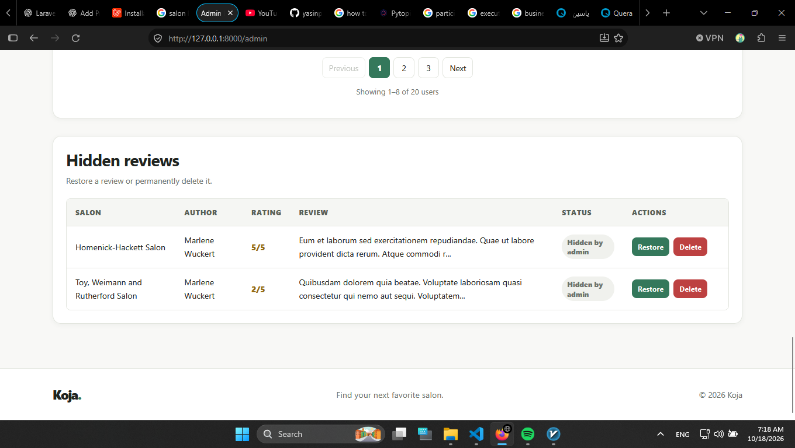

# Koja

Koja is a salon discovery and management platform. Customers can explore approved salons and leave reviews, salon owners can manage their listings and opening hours, and administrators can moderate the platform.

## Screenshots

### Salon discovery





### Salon owner dashboard



### Admin dashboard









## Built with

- PHP 8.3+ and Laravel 13
- Blade and CSS
- Tailwind CSS 4 and Vite for frontend assets

## Run locally

1. Install PHP and Node.js dependencies:

   ```sh
   composer install
   npm install
   ```

2. Create the environment file and application key:

   ```sh
   cp .env.example .env
   php artisan key:generate
   ```

3. Configure the database in `.env`, then run migrations and sample data:

   ```sh
   php artisan migrate --seed
   ```

4. Build frontend assets and start the application:

   ```sh
   npm run build
   php artisan serve
   ```
